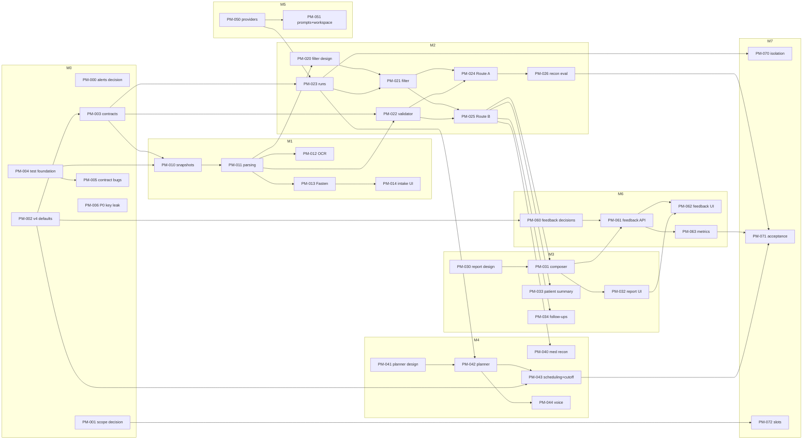

# CrossCures v4 Delivery Plan

This folder turns the gap between **MGH_App_Planning_Input_v4.docx** (product target) and the **current app** into GitHub issues that a coding agent (e.g. GPT-5 agent) can pick up, plus the decisions humans must make first.

- Product target: `specs/MGH_App_Planning_Input_v4.docx` (v4) and `specs/physician_feedback_v2.md`
- Live code today: backend `artifacts/crosscures-api/crosscures_v2`, web `artifacts/crosscures`, mobile `artifacts/crosscures-mobile`
- Placeholders (do not build on): root `crosscures/`, `artifacts/api-server`, `lib/db` schema, root `main.py`

## Folder layout

| Path | Purpose |
|---|---|
| `README.md` | This plan: milestones, issue index, dependency graph, workflow |
| `AGENT_GUIDE.md` | Standing instructions every agent must follow (guardrails, repo map, Definition of Done) |
| `EVALS.md` | Shared test/eval framework: test layers, clinical-fidelity rubric, how to report results |
| `issues/PM-xxx-*.md` | One file per GitHub issue. Body is ready to paste; includes test cases, agent evals, human evals |
| `decisions/` | ADRs produced by `type:decision` / `type:design` issues |
| `create_issues.sh` | Creates labels, milestones, and issues from `issues/` with the `gh` CLI (dry-run by default) |

## Phases

Every issue declares which phases it covers. Large or contested work is split into separate issues so humans can approve before code is written.

| Phase | Output | Who signs off |
|---|---|---|
| **Discuss / Decide** | ADR in `decisions/` with options, code impact, recommendation | Product + clinical lead |
| **Design** | Design doc / schema / UI wireframe in `decisions/` or PR | Tech lead (and clinician for clinical UX) |
| **Build** | Code + migrations behind typed contracts | Code reviewer |
| **Test** | Automated tests listed in the issue, all green in CI | Code reviewer |
| **Eval** | Agent eval report (see `EVALS.md`) attached to the PR | Tech lead; clinician for fidelity evals |
| **Review / Accept** | Human eval checklist ticked in the PR | Issue owner |

## Milestones

| Milestone | Goal | Exit criteria |
|---|---|---|
| **M0 Foundations & Decisions** | Resolve conflicts with v4, agree contracts, create test foundation, close security leak | ADR-000..003 accepted; migrations + fixtures + test clock merged; UI contract bugs fixed; key rotated |
| **M1 Source-of-Truth Intake** | Preserved originals, chart snapshots, located passages for PDF/DOCX/TXT/image/FHIR | v4 §3 checks pass on fixtures |
| **M2 Filtering & Reconstruction** | Shared clinical filter, evidence validation, run orchestration, Route A + Route B | Reconstruction eval on Charlie fixture meets thresholds in PM-026 |
| **M3 Summaries & Follow-ups** | Physician report v2 with source preview, patient summary, clinician follow-up tasks | v4 §6/§9 checks pass |
| **M4 Patient Interaction** | Med reconciliation, adaptive questions, model-proposed scheduling, cutoff, voice turns | v4 §7/§8/§9 checks pass |
| **M5 Model & Experiment Workspace** | Provider adapters, prompt registry, fresh stage experiments | v4 §11 checks pass |
| **M6 Physician Feedback** | Feedback capture, metrics, diagnostics per `physician_feedback_v2.md` | Feedback acceptance table passes |
| **M7 Hardening & Acceptance** | Isolation suite, full v4 §15 acceptance suite, integration slots | All v4 §15 rows green; Charlie replay demo |

## Issue index

Legend: 🧑 = needs human decision/sign-off before agent build; 🤖 = agent-ready once dependencies close.

| ID | Title | Type | Milestone | Depends on | Agent |
|---|---|---|---|---|---|
| PM-000 | Decide fate of therapy alerts, severity & suggested actions (v4 conflict) | decision | M0 | – | 🧑 |
| PM-001 | Decide scope of native mobile, wearables router, and extra conversation flows (v4 conflict) | decision | M0 | – | 🧑 |
| PM-002 | Decide v4 operational defaults (cutoff rule, publication, post-cutoff, reschedule) | decision | M0 | – | 🧑 |
| PM-003 | Design shared domain contracts & data model | design | M0 | PM-002 | 🧑→🤖 |
| PM-004 | Test foundation: Alembic, pytest/vitest, synthetic fixtures, test clock | build | M0 | – | 🤖 |
| PM-005 | Fix frontend/backend contract mismatches (check-in, mobile brief/alert) | bug | M0 | PM-004 | 🤖 |
| PM-006 | **P0 security:** Cartesia API key bundled into web client | bug | M0 | – | 🤖 (+ human key rotation) |
| PM-010 | Preserve original documents, content hashes, chart snapshots | build | M1 | PM-003, PM-004 | 🤖 |
| PM-011 | Parse PDF/DOCX/TXT into located source passages + coverage manifest | build | M1 | PM-010 | 🤖 |
| PM-012 | OCR for scanned PDFs and images (spike → build) | design+build | M1 | PM-011 | 🧑→🤖 |
| PM-013 | Unify Fasten FHIR import with snapshot/passage pipeline | build | M1 | PM-011 | 🤖 |
| PM-014 | Patient intake UI: two entry buttons, file states, truthful failures | build | M1 | PM-010, PM-013 | 🤖 |
| PM-020 | Design clinical text filter + labeled eval set | design | M2 | PM-011 | 🧑→🤖 |
| PM-021 | Build shared clinical filtering stage + inspection record | build | M2 | PM-020, PM-023 | 🤖 |
| PM-022 | Evidence model & deterministic evidence validator | design+build | M2 | PM-003, PM-011 | 🤖 |
| PM-023 | Analysis run orchestration, stage artifacts, publication gate | build | M2 | PM-003, PM-050 | 🤖 |
| PM-024 | Route A: one-shot review of retained clinical text | build | M2 | PM-021, PM-022 | 🤖 |
| PM-025 | Route B: fragmented longitudinal reconstruction harness | build | M2 | PM-021, PM-022 | 🤖 |
| PM-026 | Reconstruction eval harness (Charlie corrected rubric, route comparison) | eval | M2 | PM-004, PM-024 | 🤖 |
| PM-030 | Design physician report v2 IA + source preview interaction | design | M3 | PM-003 | 🧑→🤖 |
| PM-031 | Physician report composer (versioned, from validated baseline) | build | M3 | PM-025, PM-030 | 🤖 |
| PM-032 | Physician report UI v2 + accessible source preview window | build | M3 | PM-031 | 🤖 |
| PM-033 | Patient-friendly summary (composer + UI, versions) | build | M3 | PM-025 | 🤖 |
| PM-034 | Clinician follow-up tasks & in-app reminders | build | M3 | PM-025 | 🤖 |
| PM-040 | Medication reconciliation (backend + UI) | build | M4 | PM-025 | 🤖 |
| PM-041 | Design adaptive question planner (4 categories, answer states) | design | M4 | PM-003 | 🧑→🤖 |
| PM-042 | Question planner + save-before-interpret answer pipeline | build | M4 | PM-041, PM-023 | 🤖 |
| PM-043 | Model-proposed scheduling, appointment cutoff, in-app notices | build | M4 | PM-002, PM-042 | 🤖 |
| PM-044 | Voice turns: interruption, transcript correction, no duplicate answers | build | M4 | PM-042 | 🤖 |
| PM-050 | Provider adapter layer, per-stage model config, secret hygiene | build | M5 | PM-003 | 🤖 |
| PM-051 | Prompt registry + internal experiment workspace | build | M5 | PM-023, PM-050 | 🤖 |
| PM-060 | Decide physician-feedback open questions | decision | M6 | PM-002 | 🧑 |
| PM-061 | Physician feedback backend (records, revisions, idempotency) | build | M6 | PM-060, PM-031 | 🤖 |
| PM-062 | Physician feedback UI (flags + end-of-visit form) | build | M6 | PM-061, PM-032 | 🤖 |
| PM-063 | Feedback metrics & diagnostics trace view | build | M6 | PM-061 | 🤖 |
| PM-070 | Patient isolation adversarial test suite | test | M7 | PM-023 | 🤖 |
| PM-071 | v4 §15 acceptance suite + Charlie replay with test clock | test | M7 | M1–M6 | 🤖 |
| PM-072 | Integration slots: vision, watch, visit recording (unavailable states) | build | M7 | PM-001, PM-003 | 🤖 |

## Dependency graph

## Critical path

`PM-002 → PM-003 → PM-010 → PM-011 → PM-020 → PM-021 → PM-025 → PM-031 → PM-032 → PM-061 → PM-062 → PM-071`

Parallel lanes once PM-003/PM-004 land:
- **Lane A (data):** PM-010 → PM-011 → PM-012/PM-013 → PM-014
- **Lane B (LLM infra):** PM-050 → PM-023 → PM-051
- **Lane C (cleanup):** PM-006 (do immediately), PM-005, then PM-000/PM-001 implementation follow-ups
- **Lane D (eval):** PM-026 can start with fixtures + a stub route as soon as PM-004 lands

## Workflow

1. **Humans first:** hold one working session to close PM-000, PM-001, PM-002 (and later PM-060). Record outcomes in `decisions/ADR-*.md`. Decision issues are labelled `agent:prep-only`: the agent may draft the options analysis but must not change code.
2. **Create issues:** `./project_manager/create_issues.sh` (dry run) then `./project_manager/create_issues.sh --apply`. Requires `gh auth status` against `CrossCures/crosscures`.
3. **Assign:** assign 🤖 issues to the agent only when every `Depends on` issue is closed. Design issues (🧑→🤖) can be assigned to the agent to produce a draft, but the build issue stays blocked until a human approves the design.
4. **PR contract:** each PR must link its issue, tick the issue's test cases, and paste the **Agent eval report** (format in `EVALS.md`). Reviewers complete the **Human evals** checklist before merge.
5. **Weekly check:** count issues by milestone/state; any issue open > 2 review cycles gets a human pairing session; re-run PM-026 reconstruction eval after any prompt/model change.

## Risks to watch

| Risk | Mitigation |
|---|---|
| Secret exposed in web bundle (`VITE_CARTESIA_API_KEY`) | PM-006 now; rotate key |
| No automated tests exist today | PM-004 lands before any build issue |
| Synthetic chart `chart2.docx` and gold standard are not in the repo | Human must add them to `artifacts/crosscures-api/tests/fixtures/` (PM-004 prerequisite) |
| Existing alert features contradict v4 boundary | PM-000 decision before M3 UI work |
| Agents over-trust gold-standard answer | `EVALS.md` rubric encodes Appendix A corrections (vitamin D 23, AST/ALT normalization are NOT expected facts) |
| Prompt/model drift silently changes outputs | PM-023 pins prompt/model/schema per run; PM-026 is a regression gate |
| Real PHI accidentally used | Synthetic-only rule in `AGENT_GUIDE.md`; no real records in fixtures or logs |
